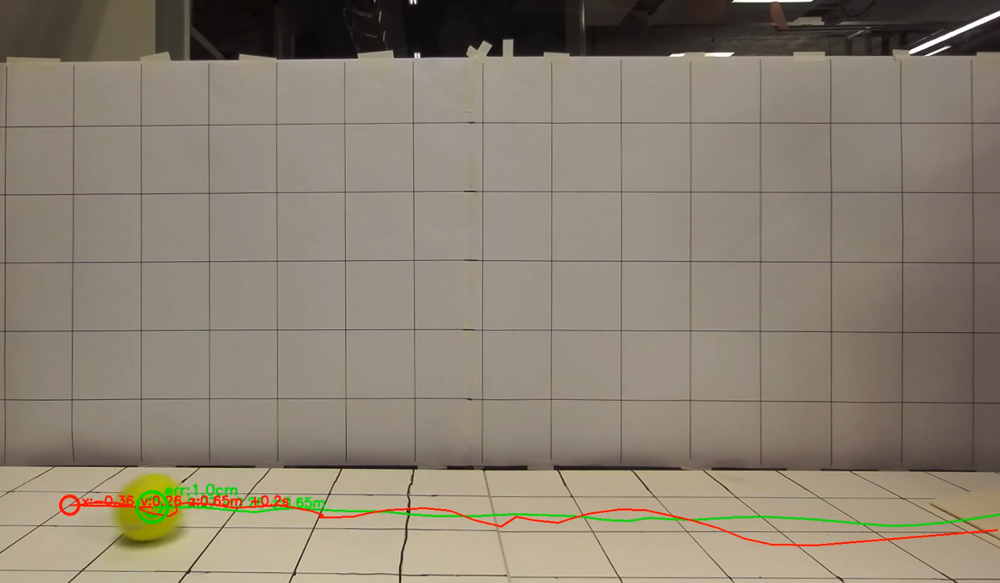
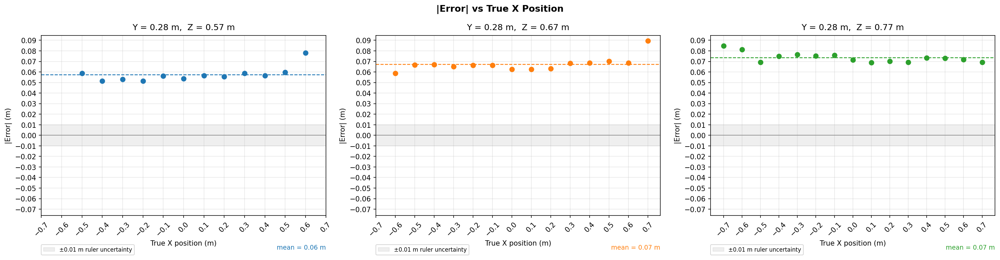
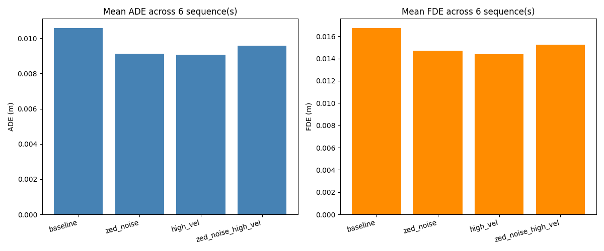

---
header-includes:
  - \usepackage{float}
  - \floatplacement{figure}{H}
---

\vspace{\baselineskip}

# Tracking and Prediction of Dynamic Obstacles using Computer Vision {.unnumbered .unlisted}

# Project Report {.unnumbered .unlisted}

\vspace{\baselineskip}

\vspace{\baselineskip}

\vspace{\baselineskip}

# Author: Vladislav Stefanov {.unnumbered .unlisted}

# Date: 2026-06-10 {.unnumbered .unlisted}

# Fontys University of Applied Sciences {.unnumbered .unlisted}

# Eindhoven, The Netherlands {.unnumbered .unlisted}

\vspace{\baselineskip}

---

## Abstract {.unnumbered .unlisted}

Mobile robots operating in dynamic environments need to detect and anticipate the motion of nearby obstacles in real time. This project develops a pipeline that combines a ZED stereo camera with YOLO v8x object detection to localize obstacles in 3D and applies a Kalman filter to track them and predict their position 0.2 seconds ahead.
Detection accuracy was evaluated across a grid of known positions, identifying two systematic biases - one in vertical position and one in depth - due to the inaccuracy of the camera. Prediction performance was assessed using average displacement error and final displacement error metrics on recorded test sequences. The results indicate that the pipeline provides sufficient accuracy for short-horizon obstacle avoidance on mobile robotics platforms.

---

\tableofcontents

\listoffigures

---

## Document versions {.unnumbered .unlisted}

| Version | Date | Description |
|---------|------|-------------|
| 1.0 | 2026-06-05 | Initial version |
| 2.0 | 2026-06-10 | Extended the document with the Research questions, Handover and Reflection sections |

---

## Introduction

Safe navigation in dynamic environments is a key challenge for mobile robots. When obstacles such as people, animals or thrown objects move in the robot's vicinity, the robot must not only detect them but also anticipate where they will be in the near future to plan a safe path.

The project builds a pipeline that addresses this problem by combining 3D object detection with motion prediction. A ZED stereo camera captures depth data, YOLO v8x detects the object in each frame and a Kalman filter tracks the object over time and predicts its position 0.2 seconds ahead. The pipeline targets deployment on mobile robotics platforms at Lectoraat HTES including the Jackal UGV, Avular Origin One and the Triangular Robot Platform.

The scope of this project covers detection accuracy characterization, prediction performance evaluation and containerized deployment using Docker. Testing was conducted using a tennis ball as a representative moving obstacle. This report gives an overview of the system design, implementation choices, evaluation methodology and results. Supporting documents are referenced throughout for readers who would like to go into more detail on a specific component.

---

## Research questions

### Main question

**How can a 3D depth-based perception pipeline reliably detect, track and predict the short-term motion of a dynamic obstacle for mobile robotics applications?**

The project answers this question with a three-stage pipeline: a stereo camera and object detector provide a 3D position each frame, a Kalman filter tracks the position and velocity over time and the same filter extrapolates a short time ahead to predict the obstacle's future position. Evaluation shows that this approach achieves centimeter-level detection and prediction accuracy, sufficient for short-horizon obstacle avoidance. As an added benefit, the pipeline also runs within the real-time constraints of the target platforms, exceeding the camera's frame rate.

\vspace{\baselineskip}

### Sub-questions

**RQ1 - Which detection, tracking and prediction methods are suitable for this application?**

A suitable approach combines an image-based object detector, which must run fast enough to keep pace with the camera and provide a 3D position each frame, with a recursive state estimator that combines these noisy measurements over time into smooth position and velocity estimates suitable for short-term extrapolation. For this project, YOLO v8x was selected for detection and a Kalman filter with a constant-velocity motion model for tracking and prediction. The reasoning behind these choices and their tradeoffs are discussed in the section Implementation.

\vspace{\baselineskip}

**RQ2 - What 3D localization accuracy can be achieved by combining ZED stereo depth with YOLO bounding boxes?**

Combining ZED stereo depth with YOLO bounding boxes gives an average 3D localization accuracy of 6.7 cm. Lateral positioning is accurate and shows no systematic trend, while the vertical and depth axes show small but consistent biases that can be corrected with fixed offsets. This level of accuracy is sufficient for short-horizon obstacle avoidance, though not for applications requiring sub-centimeter precision. Full results are given in the section Evaluation and Results.

\vspace{\baselineskip}

**RQ3 - How can a Kalman filter track an obstacle's position and velocity from noisy measurements?**

A Kalman filter tracks an obstacle by maintaining a state of position (x, y, z) and velocity (vx, vy, vz), predicting the next state from a motion model and correcting that prediction with each new noisy measurement. How much the filter trusts the model versus the measurement is controlled by its noise parameters and calibrating these to the sensor's actual error characteristics was found to improve both tracking and prediction quality. The filter design, motion model and parameter tuning are described in the section Implementation.

\vspace{\baselineskip}

**RQ4 - How accurately can the short-term future position of an obstacle be predicted from its tracked position and velocity?**

Extrapolating from the tracked position and velocity predicts an obstacle's position a short time ahead with an average error of about 1 cm and a worst-case error of about 2 cm, evaluated on smooth ball trajectories. This is accurate enough for short-horizon obstacle avoidance (<1 s). The approach works best for motion that is linear or at constant velocity. For motion involving bounces or acceleration, prediction accuracy would likely benefit from extending the motion model to account for acceleration. These results and this limitation are discussed further in the sections Evaluation, Results and Conclusions.

\vspace{\baselineskip}

---

## System Overview

The pipeline consists of three stages: detection, state estimation and prediction.

\vspace{\baselineskip}

**Detection** - A ZED stereo camera captures an RGB image and a pre-computed XYZ depth map for each frame. YOLO v8x processes the RGB image to detect the target object and returns a bounding box (bbox). The depth map is sampled within that bounding box using a front-face clustering approach, which selects the closest pixels to reduce floor and background interference. The result is a 3D position (x, y, z) in the camera frame.

\vspace{\baselineskip}

**State estimation** - A Kalman filter receives the 3D position measurement each frame and maintains a state vector of position (x, y, z) and velocity (vx, vy, vz). It blends the noisy camera measurements with a physics model to produce a smoothed position estimate and a velocity estimate.

\vspace{\baselineskip}

**Prediction** - The Kalman filter extrapolates the current state forward 0.2 seconds using a constant-velocity motion model, producing a predicted future position.

The pipeline is containerized using Docker for deployment on the target robotics platforms. A detailed description of the architecture and component design is given in the System Design document.

---

## Implementation

### 3D localization

Within the YOLO bounding box, not all depth pixels belong to the target object. Background and floor pixels near the bottom of the box can shift the computed centroid away from the object center. To reduce this effect, the pipeline uses front-face depth sampling: only pixels within 0.5 cm of the minimum depth inside the bounding box are kept. Their pixel positions are averaged to give the image coordinates (u, v) and their depth values are used to compute the final 3D position. This removes most background interference without requiring a separate segmentation step.

\vspace{\baselineskip}

### Kalman filter

A Kalman filter is used to smooth the noisy 3D position measurements from the ZED camera and to estimate the object's velocity, which cannot be measured directly from a single frame.

\vspace{\baselineskip}

**State vector** - The filter tracks six variables: position (x, y, z) and velocity (vx, vy, vz) in the camera frame. Position is observed each frame via the ZED depth map, velocity is inferred by the filter over time.

$$\mathbf{x} = [x,\ y,\ z,\ v_x,\ v_y,\ v_z]^T$$

The superscript $^T$ denotes the transpose - the values are stored as a column rather than a row, as required for the matrix multiplication in the predict step below.

\vspace{\baselineskip}

**Motion model** - The filter uses a constant-velocity model: the predicted next position is the current position plus velocity multiplied by the time step. This is the simplest physically reasonable model and works well for smooth trajectories, but does not account for acceleration, gravity or bounces. The model is encoded in the state transition matrix $F$, where $\Delta t$ is the time between frames (1/30 s at 30 fps):

$$F = \begin{bmatrix} 1 & 0 & 0 & \Delta t & 0 & 0 \\ 0 & 1 & 0 & 0 & \Delta t & 0 \\ 0 & 0 & 1 & 0 & 0 & \Delta t \\ 0 & 0 & 0 & 1 & 0 & 0 \\ 0 & 0 & 0 & 0 & 1 & 0 \\ 0 & 0 & 0 & 0 & 0 & 1 \end{bmatrix}$$

Multiplying $F$ by the state vector shows what the model predicts for each variable: each position advances by the corresponding velocity times the time step and velocity is carried forward unchanged.

$$F\mathbf{x} = \begin{bmatrix} x + v_x \Delta t \\ y + v_y \Delta t \\ z + v_z \Delta t \\ v_x \\ v_y \\ v_z \end{bmatrix}$$

A potential improvement of the system would be extending the motion model to account for acceleration.

\vspace{\baselineskip}

**Noise covariances** - Two matrices control how much the filter trusts the motion model versus the camera measurement. The measurement noise matrix is set from the results of the static accuracy experiment, with standard deviation of 0.8-1.1 cm per axis. The process noise matrix controls how quickly the velocity estimate is allowed to change between frames - a higher value lets the filter react faster to acceleration at the cost of noisier velocity estimates. The effect of these parameters on prediction accuracy is explored in the Kalman Filter Design and Tuning document.

\vspace{\baselineskip}

**Per-frame cycle** - Each frame the filter runs in two steps.

The predict step advances the state using the motion model:

$$\hat{\mathbf{x}}_k^- = F \hat{\mathbf{x}}_{k-1}$$

Here $k$ is the current frame index, a hat ($\hat{}$) denotes an estimated value and $^-$ marks the estimate before correction. At the same time, the filter tracks how uncertain it is about the current state. That uncertainty grows during predict because the model is not perfect and shrinks during correct when a new measurement arrives.

The correct step blends the prediction with the camera measurement $\mathbf{z}_k = [x, y, z]^T$. The new estimate is a weighted average of the two:

$$\hat{\mathbf{x}}_k = \hat{\mathbf{x}}_k^- + K \cdot (\mathbf{z}_k - \hat{\mathbf{x}}_k^-)$$

$K$ is the Kalman gain - a weight between 0 and 1 computed automatically each frame from the ratio of model uncertainty to total uncertainty. When the camera is precise relative to the model's current uncertainty, $K$ is high and the measurement dominates. When the model is confident and the camera is noisy, $K$ is low and the prediction dominates. The term $\mathbf{z}_k - \hat{\mathbf{x}}_k^-$ is the innovation - the difference between what the camera sees and what the model predicted.

\vspace{\baselineskip}

**Prediction** - To forecast where the object will be $t$ seconds ahead, the filter extrapolates linearly from the current smoothed position and velocity:

$$\hat{\mathbf{p}}(t) = \mathbf{p} + \mathbf{v} \cdot t$$

where $\mathbf{p} = [x, y, z]^T$ and $\mathbf{v} = [v_x, v_y, v_z]^T$ are taken from the current filter state. At 30 fps with $t = 0.2$ s this is equivalent to projecting six frames forward.

---

## Evaluation

Evaluation was split into two parts: detection accuracy and prediction performance.

\vspace{\baselineskip}

### Detection accuracy

To characterize the 3D localization error of the pipeline, a tennis ball was placed at 45 known grid positions across three distances (0.57, 0.67 and 0.77 m) and 15 lateral positions (-0.7 to +0.7 m in 0.1 m steps) at a fixed floor height. Positions were measured with a ruler (manual accuracy ±1 cm). The pipeline was run on each capture and the reported 3D position was compared against the ruler measurement. Per-axis mean error and standard deviation were computed for X (lateral), Y (vertical) and Z (depth), along with the combined 3D Euclidean error. Full methodology and results are given in the Detection Accuracy document.

\vspace{\baselineskip}

### Prediction performance

Prediction performance was evaluated by running the pipeline on 6 recorded sequences: 2 straight-line ball throws and 4 diagonal throws. For each frame where a prediction was available, the predicted position 0.2 seconds ahead was compared against the actual measured position at that future frame using two metrics:

- **ADE (average displacement error)** - the mean 3D Euclidean error across all 6 prediction steps leading up to the 0.2 s horizon.
- **FDE (final displacement error)** - the 3D Euclidean error at the final step only (0.2 s ahead).

Four Kalman filter configurations were tested, varying the process noise and measurement noise parameters. This sweep is described in detail in the Kalman Filter Design and Tuning document.

System performance was also measured per sequence: per-frame latency (mean, 95th percentile and maximum), throughput in frames per second and peak RAM and GPU memory usage.

More information about the benchmark metrics can be found in the Evaluation Metrics document.

\vspace{\baselineskip}

### Ground truth limitation

The ground truth positions used to compute ADE and FDE come from the same YOLO and ZED pipeline that drives the predictions, not from an independent source. Both the predictions and the future ground truth frames share the same systematic biases from YOLO bounding box errors and ZED depth noise, so those errors partially cancel in the reported metrics. As a result, ADE and FDE likely underestimate the true prediction error relative to the real-world position of the ball.

---

## Results

| Metric | Value | Notes |
|--------|-------|-------|
| Detection rate | 41/45 (91%) | Misses at extreme lateral positions only |
| X error (lateral) | -1.1 cm ± 0.8 cm | No systematic trend |
| Y error (vertical) | -5.0 cm ± 1.1 cm | Correctable with +5.0 cm offset |
| Z error (depth) | +4.1 cm ± 0.8 cm | Correctable with -4.1 cm offset |
| Combined 3D error | 6.7 cm ± 0.9 cm | Dominated by Y and Z biases |
| ADE (best config) | 1.3 cm | Averaged across 6 sequences at 0.2 s horizon |
| FDE (best config) | 2.1 cm | At 0.2 s horizon |
| Latency p95 | 8.9 ms | Per frame end-to-end |
| Throughput | 35.8 fps | Exceeds 30 fps camera rate |
| RAM peak | 2.6-3.2 GB | Varies by config |

### Detection accuracy

The pipeline detected the ball in 41 out of 45 captures. The 4 misses occurred at the most extreme lateral positions at the two shorter distances, where the ball was outside the camera's field of view. Per-axis error results are shown in the table below.

| Axis | Mean error | Std | Character |
|------|-----------|-----|-----------|
| X (lateral) | -1.1 cm | 0.8 cm | No systematic trend |
| Y (vertical) | -5.0 cm | 1.1 cm | Systematic negative bias |
| Z (depth) | +4.1 cm | 0.8 cm | Systematic positive bias |
| Combined | 6.7 cm | 0.9 cm | - |

Lateral (X) localization is reliable with no clear trend across position or distance. The Y and Z axes show consistent biases. The Y bias is most likely caused by the camera measuring the top surface of the ball rather than its center. The Z bias is most likely caused by the ZED NEURAL depth mode overestimating distance at close range (<1 m). Both biases are stable enough to be corrected with fixed offsets: +5.0 cm on Y and -4.1 cm on Z. Full analysis and per-capture data are in the Detection Accuracy document.

### Prediction performance

The table below shows mean ADE and FDE averaged across all 6 sequences for each Kalman filter configuration.

| Configuration | Mean ADE | Mean FDE | Latency p95 | Throughput |
|--------------|---------|---------|------------|-----------|
| baseline | 1.5 cm | 2.4 cm | 8.8 ms | 34.9 fps |
| zed_noise | 1.3 cm | 2.1 cm | 8.9 ms | 35.8 fps |
| high_vel | 1.3 cm | 2.1 cm | 8.8 ms | 35.8 fps |
| zed_noise_high_vel | 1.3 cm | 2.1 cm | 8.8 ms | 35.8 fps |

The three non-baseline configurations perform equivalently at 1.3 cm mean ADE and 2.1 cm mean FDE, both slightly better than the baseline. The improvement can come from either of two independent changes: calibrating the measurement noise from the static ZED experiment (zed_noise), or raising the process noise to allow faster velocity adaptation (high_vel). Each change alone produces the same gain and combining them (zed_noise_high_vel) yields no further improvement. Latency and throughput are consistent across all configurations, with p95 latency around 9 ms and throughput above 35 fps. Peak RAM usage ranged from 2.6 to 3.2 GB across configurations. Detailed per-sequence results are in the sweep_results.csv output file.

---

## Conclusions

The pipeline demonstrates that a ZED stereo camera and YOLO v8x can provide sufficient 3D localization accuracy for short-horizon motion prediction on mobile robotics platforms. The main findings are:

\vspace{\baselineskip}

**Detection accuracy is usable but biased.** The pipeline localizes the ball to within 6.7 cm on average. The lateral (X) error is small and unbiased. The vertical (Y) and depth (Z) errors are systematic and predictable and both can be corrected with fixed offsets without custom calibration.

\vspace{\baselineskip}

**Prediction accuracy is good for smooth trajectories.** The best configurations achieve 1.3 cm mean ADE and 2.1 cm mean FDE at the 0.2 s horizon. This is within the correction range of the detection biases and is likely sufficient for obstacle avoidance applications where centimeter-level precision is not required.

\vspace{\baselineskip}

**Calibrated noise parameters improve results.** Setting the Kalman filter's measurement noise covariance from the static accuracy experiment, rather than using default values, consistently reduces both ADE and FDE. This suggests that tuning noise parameters to the actual sensor characteristics is worth the effort even for simple configurations.

\vspace{\baselineskip}

**The pipeline runs in real time.** With p95 latency under 9 ms and throughput above 35 fps, the pipeline comfortably exceeds the 30 fps camera rate, leaving headroom for downstream processing on the target platforms.

\vspace{\baselineskip}

**The reported prediction error is likely optimistic.** Because the ground truth is derived from the same YOLO and ZED pipeline, systematic errors cancel in the ADE and FDE calculation. An evaluation against independently annotated ground truth would give a more accurate picture of real-world prediction quality.

\vspace{\baselineskip}

**The constant-velocity model is the main limiting assumption.** The model performs well on straight-line and diagonal throws but will lag on bounces, accelerating motion or curved trajectories. For applications where the obstacle exhibits non-linear motion, a more expressive motion model such as one accounting for acceleration would be the natural next step.

---

## Recommendations

The following extensions to the delivered pipeline would increase the system's capability and readiness for real-world deployment.

\vspace{\baselineskip}

**Multi-object tracking**

The current pipeline tracks a single object at a time. Extending it to handle multiple simultaneous obstacles would be required for real deployment, where a robot may encounter several moving objects at once. This would involve associating each new detection with an existing track across frames and maintaining a separate Kalman filter state per tracked object.

\vspace{\baselineskip}

**Real platform deployment and performance testing**

All evaluation was conducted on recorded SVO files on a development machine. Deploying the pipeline on a Jetson compute module mounted on the Jackal UGV or Avular Origin One would test real-time performance under embedded hardware constraints, where memory and compute budget are more limited. Key metrics to re-evaluate on-platform are end-to-end latency, throughput and peak RAM usage.

\vspace{\baselineskip}

**Interface to the vehicle motion planar**

The pipeline currently outputs a single predicted 3D position 0.2 seconds ahead. To be useful to an autonomous vehicle, this output needs to be translated into an actionable signal for the motion planner. A practical interface would publish, for each tracked obstacle, the full sequence of predicted positions over the prediction horizon - for example six (x, y, z) positions at 33 ms intervals leading up to 0.2 s. The motion planner can then check whether any predicted position falls within a safety corridor in front of the robot and compute a time-to-collision estimate. A stop command would be issued when a predicted obstacle position enters the robot's forward zone within the horizon, allowing the platform to halt before the obstacle reaches its path rather than reacting only once it is already present.

---

## Project handover

This section outlines longer-term research directions for a continuation of this project and how they connect to the broader research agenda of the HTES research group.

The original project plan framed an investigation in both classical and world-model approaches as a research objective. Within this project, world models were researched only theoretically, through literature study and small-scale experiments and were not implemented or evaluated as part of the delivered pipeline. Researching thise technologies further remains an open direction for a continuation project.

- **Depth Anything v3 (DA3)** - early in the project, DA3 was used to generate a point cloud of a room from a single camera, with promising results. A continuation could test DA3 more thoroughly on a physical robot platform such as the Jackal UGV.
- **JEPA / V-JEPA** - identified by stakeholders as a promising direction for a follow-up project. The pipeline and results from the current project can serve as a classical baseline against which a JEPA-based approach could be compared.
- **Other technologies** - NVIDIA Cosmos, Dreamer v3, DynamicNeRF, HexPlane, SMORE, MONet, ConceptGraphs, Isaac Perceptor and Dino v2 were identified in the project plan but not yet researched or tested. These remain candidates for future investigation, to be prioritized based on their relevance and maturity at the time.

The evaluation approach developed in this project could be reused or extended when assessing future world-model approaches, so that results remain comparable to the classical baseline established here.

\vspace{\baselineskip}

**Alignment with the HTES research group**

 This project delivers a reusable tracking and prediction module for dynamic obstacles, targeting HTES robotics platforms including the Jackal UGV, the Avular Origin One, the Triangular Robot Platform and the Brum. A continuation of this project, including the world-model directions described above, fits into the broader HTES research agenda in several application areas:

- **Product identification and quality determination**: the 3D localization and object detection modules could support identifying objects and checking their position or dimensions.
- **Robots for basic manufacturing actions**: the tracking and prediction module supports safe operation around moving obstacles during manipulation tasks.
- **Scene interpretation**: world-model approaches such as DA3, point clouds and Cosmos point toward general scene understanding in dynamic environments, not just static ones.

These areas have been discussed with Teade Punter who agreed that they align with the long-term research direction of the HTES.

---

## Reflection

**Knowledge gained**

This project gave me broad hands-on experience on computer vision, perception pipelines and 3D data manipulation.

On the technical side, I gained knowledge of stereo vision and depth cameras through the ZED SDK, object detection through YOLO and classical tracking methods through the design and tuning of a Kalman filter. I also got an introduction to world models for dynamic scene understanding through Depth Anything v3 and NVIDIA Cosmos. 

Beyond these individual components, I learned how to integrate them into a single system, how to characterize and correct systematic camera detection inaccuracies and how to design an evaluation methodology for a perception and prediction pipeline.

On the infrastructure side, I gained experience with Docker for cross-platform deployment on x86 and Jetson, with the NVIDIA software and hardware stack and with developing remotely on a host development machine over SSH.

Beyond these technical skills, I further developed my systems thinking, multidisciplinary thinking and analytical thinking, as well as team work.

\vspace{\baselineskip}

**Approach and methodology**

I worked according to Scrum, in sprints of two to three weeks with a Git issue board and weekly meetings with stakeholders, which helped me improve the stakeholder feedback loop throughout the project.

Additionally, I followed a research-implement-test cycle based on the engineering design process: defining the problem, researching and prototyping possible solutions, testing and evaluating them and refining the system before the next cycle. This gave me the structure for narrowing down design choices, such as choosing between RGB-D and point cloud representations or gradually improving the Kalman filter configuration. Thus, I worked in continuous cycles of design, prototyping and analysis  to refine both a solution and the understanding behind it.

\vspace{\baselineskip}

**What went well**

- Technical problem-solving

A major accomplishment was successfully working through a wide range of technical issues, for example configuring the ZED SDK with the correct CUDA, TensorRT and OpenGL driver versions and getting the Docker setup working on both x86 and Jetson. Two skills I further developed are splitting a large problem into smaller ones and solving them one by one before moving to the next step and persistence in pushing forward despite a lot of unclarity and uncertainty in the research process.

- Documentation and stakeholder communication

I delivered documentation that is detailed and coherent, keeping the work understandable and reproducible. I also maintained effective and ongoing communication with stakeholders, with regular meetings and progress updates that kept the work aligned with their needs and interests.

- Risk management

Risks identified in the project plan were managed successfully. Scope creep was avoided by defining a strict MVP, holding frequent feedback sessions with stakeholders and prioritizing experiments over open-ended research, for example by limiting the world-model investigation to a literature study rather than a full implementation. Technical complexity was managed by starting with a simple baseline Kalman filter and incrementally increasing complexity. Evaluation ambiguity was addressed by defining the detection accuracy and prediction performance metrics early in the project. Additionally, time constraints were managed by including buffer time and working in sprints with a Git issue board.

\vspace{\baselineskip}

**What could be improved**

Despite these successes, there were areas where I could improve. Timeboxing was inconsistent, which affected my ability to deliver within tight timeframes. I spent a lot of time on open-ended research in the first half of the assignment instead of setting up a prototype. I recognized the need to be more analytical and critical in my thinking, rather than getting distracted and losing the main picture. I also struggled at times with perfectionism, waiting too long before taking action or considering a task complete. In future projects, I will focus more on taking action and improving gradually, rather than trying to make every step perfect from the start. 

\vspace{\baselineskip}

**Personal findings**

This project helped me better understand how to approach complex engineering challenges, by breaking them down, working iteratively and staying in close contact with stakeholders. It also confirmed my curiosity and interest in the multidisciplinary field of computer vision, robotics and autonomous systems. As a result, it influensed my decision to enrol in the program Master Applied IT at Fontys in the next academic year.

---

## References

- TWI Global. (n.d.). *The Engineering Design Process*. www.twi-global.com/technical-knowledge/faqs/engineering-design-process

- Design-Based Research Collective. (2003). Design-based research: An emerging paradigm for educational inquiry. Educational Researcher, 32(1), 5-8, 35-37. www.designbasedresearch.org/reppubs/DBRC2003.pdf