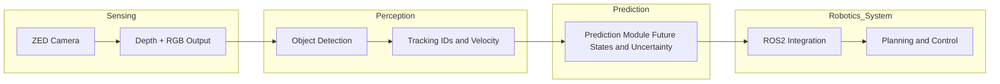

# 3D Perception Pipeline

**Overview:**  
A 3D perception pipeline is a modular system that converts raw sensor data into structured, object-level understanding of a dynamic environment.

**Core idea:**  
A 3D perception pipeline processes raw sensory input (e.g., depth or RGB-D data) through sequential stages such as detection, tracking, and prediction. First, it extracts meaningful entities (objects) from noisy sensor measurements. Then, it maintains consistent identities of those objects across time using tracking methods. Finally, it estimates their future motion, often under uncertainty. Each stage refines the representation: from low-level geometry to high-level semantic and temporal understanding. The pipeline is typically modular, allowing different algorithms (classical or AI-based) to be swapped and evaluated independently.

While often modeled as sequential, in practice many components interact bidirectionally or are jointly optimized.

**Input:**
- Depth data (point clouds, depth maps)
- RGB or RGB-D images
- LiDAR scans (optional alternative; not used in this project)

**Output:**
- Object detections (positions, bounding boxes, object classes)
- Object tracks (IDs and trajectories over time)
- Short-term motion predictions (future states with uncertainty)

**Depends on:**
- Sensor hardware (depth cameras, LiDAR)
- Preprocessing (calibration, filtering, synchronization)
- Detection algorithms (e.g., clustering, neural networks)
- Tracking methods (e.g., Kalman filter, data association)
- Prediction models (kinematic models, learned models)
- Compute constraints (real-time requirements, GPU/CPU availability)

**Used in:**
- Autonomous driving systems
- Mobile robotics (e.g., UGVs, delivery robots)
- Industrial automation
- Human-robot interaction
- Surveillance and safety systems    
---
## **Occlusion**

**Overview:**  
Occlusion occurs when one object blocks another from the camera’s view, causing partial or complete loss of visible information.

**Core idea:**
In any vision system, the camera only observes surfaces that are directly visible along its line of sight. When an object is in front of another, it prevents light from the background object from reaching the sensor. This results in missing data - parts of the scene are not captured at all. In depth sensing, occlusions create holes or discontinuities because no valid depth can be computed for hidden regions. Occlusions can change dynamically as objects move, making tracking difficult. In perception pipelines, they are a major source of uncertainty and errors, especially for detection and tracking.

Example for occlusion. The car behind cannot see the pedestrian crossing in front of the other car because part of the visual information is hidden.

---
# Noise

**Overview:**  
Noise is random, inaccurate variation or error in sensor measurements that deviates from the true physical value.

**Core idea:**
All sensors produce imperfect measurements due to physical, electronic, and environmental limitations. Instead of observing the true value, the system observes a corrupted version where random fluctuations are added. Noise is modeled as: `z = x + ϵ`, where `x` = true state, `z` = measurement and `ϵ` (epsilon) = noise (random variable). In vision and depth sensing, this means pixel values or distances are slightly incorrect, inconsistent, or unstable over time. Noise is typically modeled as a random process (often Gaussian), but in practice it can be structured (e.g., edge artifacts, reflections). Unlike occlusion (missing data), noise is present but inaccurate data. In perception pipelines, noise propagates through all stages - detection, tracking, and prediction - degrading reliability.

The black gaps on the image represent noise.

---
# **Clutter**

**Overview:**  
Clutter refers to environments where many objects or structures are densely packed, making it difficult to distinguish individual objects.

**Core idea:**
In cluttered scenes, multiple objects are close together, overlapping, or partially occluding each other, leading to complex visual and geometric patterns. Sensors capture all visible surfaces, but the separation between objects becomes ambiguous due to proximity and noise. In depth or point cloud data, clutter appears as dense, intertwined regions where boundaries between objects are unclear. This increases the difficulty of segmentation and data association, especially when objects have similar shapes or are moving. In dynamic environments, clutter further complicates tracking because objects frequently interact, merge, or split in the sensor representation.

---

# Perception Pipeline Input Data
Comparison between different kinds of input data.

---
# Raw RGB Images (Stereo or Monocular)

**Overview:**  
Raw RGB images are 2D color representations of a scene captured by one or more cameras without explicit depth information.

**Core idea:**  
A camera sensor captures light intensity across red, green, and blue channels, producing a 2D projection of the 3D world. In monocular setups, a single viewpoint is used, meaning depth must be inferred indirectly through learned models or motion cues. In stereo setups, two cameras with a known baseline enable depth estimation via triangulation, although the raw input itself remains RGB images. These images preserve rich semantic information such as texture, color, and object appearance, which is critical for recognition tasks. However, geometric structure is not directly encoded, making spatial reasoning more challenging without additional processing.

**Input:**  
Light captured by one camera (monocular) or two synchronized cameras (stereo), converted into RGB pixel arrays.

**Output:**  
2D image(s) with pixel values typically represented as height × width × 3 (RGB channels).

**Depends on:**  
Camera sensor quality, lens properties, lighting conditions, exposure settings, and calibration (esp. for stereo setups).

**Used in:**  
Object detection, image classification, semantic segmentation, visual SLAM, and as a base input for depth estimation methods.

---
# Depth Maps

**Overview:**  
A depth map is a 2D image where each pixel stores the distance from the camera to the observed surface in the scene.

**Core idea:**  
A depth sensor (e.g., stereo camera, structured light, or time-of-flight) estimates the distance to objects for every pixel in the image. The result is a dense or semi-dense map where pixel intensity encodes depth rather than color. This provides direct geometric information about the scene, enabling spatial reasoning such as obstacle distance and shape. However, the representation is still viewpoint-dependent, meaning it only captures what is visible from the camera perspective. Depth maps are often noisy, contain missing values (holes), and degrade under certain conditions like reflective or textureless surfaces. Despite these limitations, they are a primary intermediate representation for constructing 3D understanding.

**Input:**  
Sensor measurements from depth cameras (e.g., stereo disparity, infrared patterns, or time-of-flight signals).

**Output:**  
2D array where each pixel value represents distance (typically in meters or millimeters).

**Depends on:**  
Sensor type (stereo, ToF, structured light), calibration accuracy, baseline (for stereo), lighting conditions, surface properties, and reconstruction algorithms.

**Used in:**  
Obstacle detection, scene reconstruction, segmentation, SLAM, and as input for point cloud generation or RGB-D fusion.

---
# RGB-D (Color and Depth)

**Overview:**  
RGB-D is a representation that combines a color image with a corresponding depth map, providing both appearance and geometric information per pixel.

**Core idea:**  
An RGB-D sensor captures a standard RGB image alongside a depth map that is spatially aligned with it. Each pixel therefore contains both visual features (color, texture) and geometric information (distance), enabling richer scene understanding than either modality alone. This fusion allows algorithms to reason about object identity and spatial structure simultaneously, improving tasks like segmentation and tracking. However, the representation remains view-dependent and inherits the weaknesses of depth sensing, such as noise and missing values. Proper calibration and synchronization between RGB and depth channels are required to ensure accurate alignment.

**Input:**  
Synchronized RGB image and depth measurements from a sensor (e.g., stereo camera like ZED, or RGB-D camera like Kinect).

**Output:**  
Aligned RGB image and depth map, often represented as a combined data structure where each pixel has (R, G, B, depth).

**Depends on:**  
Sensor calibration (intrinsics and extrinsics), synchronization between streams, depth estimation quality, and alignment algorithms.

**Used in:**  
Object detection with spatial awareness, 3D scene understanding, human tracking, robotics perception pipelines, and as input for point cloud generation.

---
# Point Cloud

## Point Clouds

**Overview:**  
A point cloud is a set of 3D points representing the spatial structure of a scene in real-world coordinates.

**Core idea:**  
Point clouds are generated by projecting depth measurements into 3D space using camera calibration parameters. Each point typically contains spatial coordinates (x, y, z) and may include additional attributes such as color or intensity. Unlike images, point clouds are unstructured, meaning they do not lie on a regular grid, which makes them more flexible but harder to process. This representation enables direct geometric reasoning, such as measuring distances between objects, estimating velocities, and tracking motion in a consistent coordinate frame. However, point clouds are often sparse, noisy, and computationally expensive to process, especially in real-time systems. Efficient algorithms and data structures are required to handle them.

**Input:**  
Depth data (from stereo, RGB-D, or LiDAR) combined with camera calibration parameters to project pixels into 3D coordinates.

**Output:**  
A set of 3D points (x, y, z), optionally with additional features such as RGB color or intensity.

**Depends on:**  
Depth quality, sensor calibration (intrinsics and extrinsics), coordinate transformations, and point cloud processing libraries (e.g., PCL, Open3D).

**Used in:**  
3D object detection, clustering, multi-object tracking, mapping, collision avoidance, and motion prediction in robotics and autonomous systems.

---
# LiDAR Point Cloud

**Overview:**  
A LiDAR point cloud is a 3D representation of the environment generated by measuring distances using laser pulses.

**Core idea:**  
LiDAR sensors emit laser beams and measure the time it takes for each pulse to return after hitting a surface, allowing precise distance estimation. By sweeping these beams across the environment, the sensor constructs a 3D point cloud in real time. Compared to camera-based depth, LiDAR provides more accurate and consistent distance measurements, especially over long ranges and in varying lighting conditions. However, the resulting point cloud is typically sparse and lacks semantic information such as color or texture. The structured scanning pattern (e.g., rings in rotating LiDAR) also introduces anisotropic resolution, meaning some areas are sampled more densely than others.

**Input:**  
Laser time-of-flight measurements and sensor pose information (orientation and position).

**Output:**  
3D point cloud with coordinates (x, y, z), often with additional attributes like intensity or reflectivity.

**Depends on:**  
LiDAR hardware (e.g., number of channels, scan frequency), sensor calibration, mounting position, and motion compensation (for moving platforms).

**Used in:**  
Autonomous driving, large-scale mapping, localization (SLAM), obstacle detection, and multi-object tracking in outdoor robotics.

---
