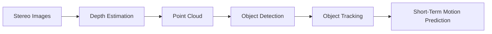
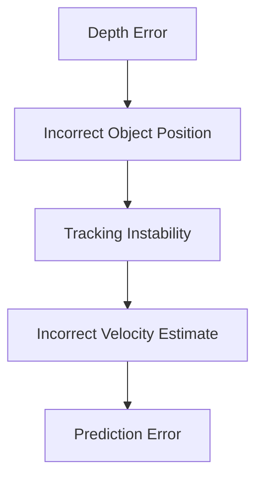

# Technical Challenges of Stereo Depth-Based Perception in Dynamic Indoor Robotics Environments

## Research Question

> What are the technical challenges of depth-based perception in dynamic robotics environments?

---

## 1. Introduction

This document investigates the technical challenges of stereo depth-based perception in dynamic indoor robotics environments. The focus is on stereo cameras such as the ZED 2i (the one used in the project), with the goal of understanding how perception limitations affect object tracking and short-term motion prediction.

A stereo depth camera estimates depth by comparing two synchronized camera images. The ZED 2i is designed for stereo depth sensing and can generate depth maps and point clouds from left and right camera views. In robotics, this information can be used to detect obstacles, track moving objects and estimate short-term future motion.

Indoor dynamic environments are challenging because objects such as humans, robots and furniture may move or partially block each other. For this project, the most important downstream task is short-term prediction below one second. This means that even small perception errors can matter, because object velocity and future position are estimated from recent observations.

---

## 2. Perception-to-Prediction Pipeline

A simplified stereo perception pipeline can be represented as follows:

Stereo depth estimation is based on disparity: the difference in position between corresponding image features in the left and right camera images. Larger disparity usually means the object is closer, while smaller disparity usually means the object is farther away. The resulting depth map can then be converted into a 3D point cloud. A point cloud represents the environment as a set of three-dimensional spatial points that can be used for obstacle localization and scene understanding.

 
The final prediction quality depends on the stability of the earlier perception stages. If depth estimation is noisy, object detection becomes less stable. If detections are unstable, tracking becomes less reliable. If tracking is unreliable, velocity estimation and short-term prediction also become unreliable.

---

## 3. Main Technical Challenges

### 3.1 Sensor Noise and Depth Uncertainty

Stereo depth estimation depends on finding reliable visual correspondences between two camera images. This becomes difficult when surfaces have little texture, when lighting is poor or when objects are reflective or transparent. In these cases, the depth map may contain unstable or incorrect values.

For a moving object, noisy depth values can cause the estimated object position to fluctuate between frames. This is especially problematic for short-term prediction because velocity is calculated from position changes over time. A small position error can therefore become a larger prediction error.

The ZED SDK provides a confidence map that can be used to identify less reliable depth pixels. This helps reduce the use of uncertain depth data, but it does not solve the underlying stereo matching problem.

Common mitigation methods include:
- confidence thresholding
- temporal filtering
- outlier removal
- Kalman filtering

The tradeoff is that stronger filtering may improve stability but reduce responsiveness to sudden object motion.

---

### 3.2 Occlusion

Occlusion happens when an object becomes partially or fully hidden from the camera. In indoor robotics, this can occur when a person walks behind another person, behind furniture or outside the camera field of view.

Occlusion is a major tracking problem. If an object disappears temporarily, the system may lose its identity or assign the wrong identity when it reappears. Object tracking literature identifies occlusion, abrupt motion, changing appearance and camera motion as common difficulties in tracking systems.

For short-term prediction, occlusion reduces the number of recent observations available for estimating motion. If the system cannot observe an object for several frames, it must rely on extrapolation instead of measurement. This increases uncertainty.

Common mitigation methods include:
- motion-based prediction during temporary disappearance
- Kalman filtering
- data association across frames
- track confidence scores

However, stereo vision from a single viewpoint cannot fully solve occlusion. If the camera cannot see the object, the missing information must be estimated rather than measured.

---

### 3.3 Incomplete Point Clouds

Stereo depth systems often produce incomplete point clouds. Missing regions can occur around object edges, reflective surfaces, transparent materials or low-texture areas. Thin objects and distant objects may also be poorly reconstructed.

Incomplete point clouds affect object detection and tracking because the perceived shape or position of an object may change between frames. For example, if only part of a moving object is visible in the point cloud, the estimated object center may shift even when the real object motion is smooth.

This matters for prediction because trajectory estimation depends on consistent object positions. If the point cloud representation changes unpredictably, the tracker may estimate incorrect velocity or direction.

Possible mitigation methods include:
- voxel filtering
- temporal accumulation
- object-level tracking instead of raw point tracking
- ignoring low-confidence depth regions

These methods can improve stability but may increase processing time or introduce delay.

---

### 3.4 Moving Objects and Tracking Instability

Dynamic environments require the robot to associate detections across sequential frames. This is known as object tracking. In simple cases, an object can be tracked by comparing position changes between frames. In harder cases, multiple similar objects may move close to each other, disappear behind obstacles or change direction suddenly.

Tracking instability can cause:
- missed tracks
- duplicated tracks
- identity switches
- incorrect velocity estimates

For this project, tracking instability is especially important because prediction depends on the tracked history of each object. If the tracker switches identities between two moving objects, the prediction module may estimate a trajectory that does not correspond to either real object.

Classical tracking approaches often use Kalman filters and assignment algorithms. These methods are efficient and suitable for real-time robotics, but they depend on reasonably stable detections.

---

### 3.5 Real-Time Constraints

Robotic perception must run fast enough to support safe motion. Stereo depth estimation, point cloud processing, detection, tracking and prediction all require computation. If processing is too slow, the robot may make decisions using outdated information.

This is especially important for prediction horizons below one second. For example, if the perception pipeline has high latency, the predicted future position may already be outdated by the time it is used. For example, in robotics systems operating at 30 FPS, a delay of several frames may significantly reduce the usefulness of short-term predictions because the environment may already have changed before the prediction is applied.

The ZED 2i supports high depth frame rates depending on settings, and the ZED SDK provides GPU-accelerated depth processing. However, higher accuracy settings, higher resolutions and more complex processing usually increase computational load.

The main tradeoff is:

| Goal | Possible Cost |
|---|---|
| Higher depth accuracy | More computation |
| Stronger filtering | More latency |
| More stable tracking | Slower reaction to sudden motion |
| More objects tracked | Lower frame rate |

Hardware acceleration using GPUs and optimized software such as the ZED SDK can improve runtime performance, but this does not remove the underlying uncertainty caused by stereo matching errors, occlusion and missing depth data.

---

## 4. Summary of Challenges

| Challenge | Main Cause | Effect on Prediction |
|---|---|---|
| Sensor noise | Unreliable stereo matching | Unstable object positions |
| Occlusion | Partial or missing visibility | Lost tracks and identity switches |
| Incomplete point clouds | Missing depth data | Inconsistent object centroids |
| Tracking instability | Noisy detections and dynamic motion | Incorrect velocity estimates |
| Real-time constraints | Computational cost | Outdated predictions |

---

## 5. Conclusion

Stereo depth-based perception is useful for indoor robotics because it provides 3D information for detecting and tracking obstacles. However, dynamic environments introduce several technical challenges that reduce reliability.

The main challenges are sensor noise, occlusion, incomplete point clouds, tracking instability and real-time constraints. These challenges are connected: errors in depth estimation can cause unstable detections, unstable detections can cause tracking errors and tracking errors can cause unreliable short-term motion prediction.

For a project focused on prediction below one second, perception stability and latency are critical. Classical methods such as filtering, confidence thresholding and motion-based tracking can reduce some errors, but they cannot fully remove uncertainty from stereo depth perception. Therefore, any prediction system built on stereo depth data should explicitly account for noisy measurements, missing observations and processing delay.

---
## References

Abdelsalam, A., Mansour, M., Porras, J., & Happonen, A. (2024). Depth accuracy analysis of the ZED 2i stereo camera in an indoor environment. *Robotics and Autonomous Systems, 179*, Article 104753. https://doi.org/10.1016/j.robot.2024.104753

Stereolabs. (n.d.-a). *ZED 2i stereo camera*. https://www.stereolabs.com/store/products/zed-2i

Stereolabs. (n.d.-b). *Depth settings*. https://www.stereolabs.com/docs/depth-sensing/depth-settings

Stereolabs. (n.d.-c). *Using the depth sensing API*. https://www.stereolabs.com/docs/depth-sensing/using-depth
