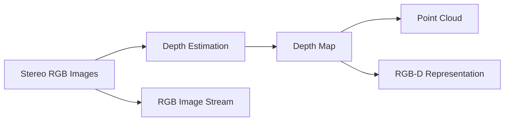
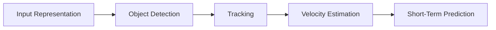
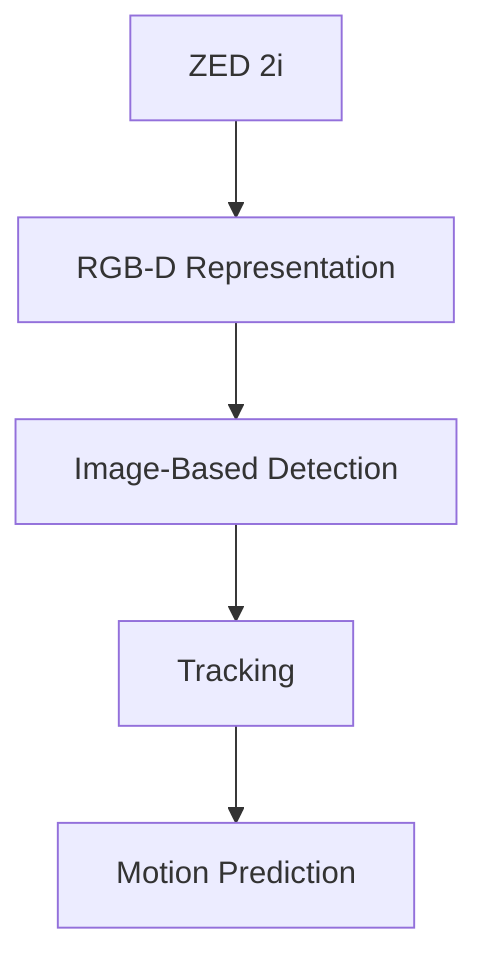
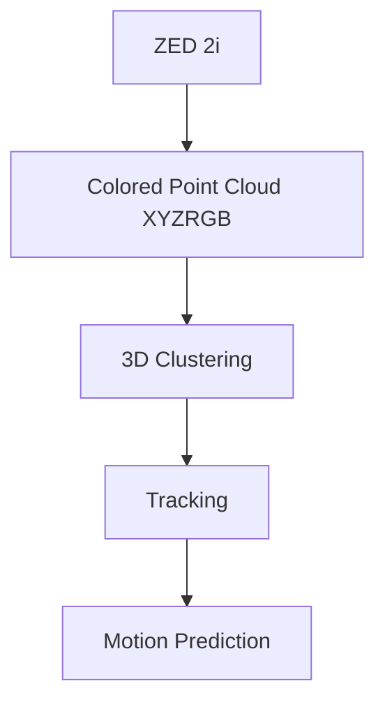
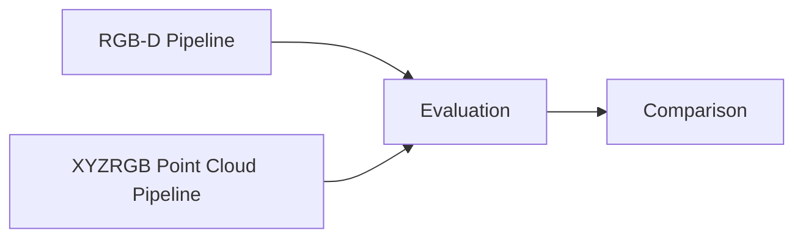

# Research on Input Data Representation for Dynamic Obstacle Detection and Prediction

## Research Question

> Which input data representation is the most suitable for a modular dynamic obstacle detection, tracking and motion prediction system using the ZED 2i stereo camera?

---

# 1. Introduction

The design of a robotics perception pipeline strongly depends on the chosen input data representation. The ZED 2i stereo camera and ZED SDK provide multiple possible scene representations, including RGB images, depth maps, RGB-D data and point clouds.

Each representation provides different advantages for robotics tasks such as:
- obstacle detection
- object tracking
- motion estimation
- trajectory prediction
- semantic understanding

The goal of this research is to analyze the available input data representations and determine which representation is the most suitable for a modular perception pipeline focused on dynamic obstacle detection, tracking and short-term motion prediction in indoor robotics environments.

The project primarily focuses on robotics-oriented geometric perception rather than semantic scene understanding. Because of this, the representation must support reliable spatial reasoning, object localization, velocity estimation, temporal consistency and future trajectory prediction.

---

# 2. Available Input Representations from the ZED 2i

The ZED 2i internally computes stereo depth from synchronized RGB camera images. The ZED SDK can expose this information in multiple forms.



---

## 2.1 RGB Images

RGB images contain standard color and texture information.

Representation: 2D image(s) with pixel values typically represented as 
```
height × width × 3 (RGB channels)
```

RGB images provide textures, edges, colors and semantic appearance information.

Advantages:
- low memory footprint compared to point clouds  
- directly compatible with image-based AI models  (e.g., YOLO)
- efficient for semantic classification tasks

Disadvantages:
- no explicit geometry  
- object motion cannot be estimated directly in 3D space  
- obstacle distance must be inferred separately  
- difficult to perform geometric tracking reliably

RGB-only representations are therefore insufficient for the current project goals because prediction and tracking require reliable spatial information.

---

## 2.2 Depth Maps

Depth maps contain per-pixel distance information representing the estimated distance between the camera and the observed scene.  
  
Representation: 2D matrix where each pixel stores a depth value  (in mm or m)
```text  
height × width × 1 (depth channel)  
```  
  
Depth maps provide geometric distance information, approximate scene structure and obstacle proximity information.

Where each pixel with coordinates H and W represents distance (mm or m) from the camera.

Advantages:
- direct depth information available  
- computationally cheaper than dense point clouds  
- efficient for obstacle distance estimation

Disadvantages:
- geometry remains image-based
- spatial relationships are implicit
- difficult to perform direct 3D reasoning

Although depth maps improve geometric understanding compared to RGB images, they are still fundamentally two-dimensional representations. Additional processing is required to reconstruct explicit three-dimensional spatial structure.

---

## 2.3 RGB-D Data

RGB-D data combines RGB images with aligned depth information.  
  
Representation: synchronized RGB image and depth map (R, G, B, Depth). Every pixel stores the three color channels and the depth value (in mm or m).
```text  
RGB : height × width × 3  
Depth : height × width × 1  
``` 
  
RGB-D representations provide semantic appearance information together with geometric depth information, visual texture and color.

Advantages:  
- preserves semantic and geometric alignment  
- compatible with modern computer vision architectures  
- useful for segmentation and object classification  
- efficient integration with foundation models  
  
Disadvantages:  
- still fundamentally image-based  
- direct Euclidean geometry operations are inefficient  
- motion estimation still requires coordinate reprojection  
- neighborhood operations remain pixel-centric

RGB-D is highly suitable for semantic computer vision tasks, but it is less optimal for direct robotics geometry processing.

---

## 2.4 Point Clouds

The ZED SDK can convert stereo depth information into a point cloud. Point clouds represent the environment as a collection of points in three-dimensional Cartesian space.  
  
Representation: unordered set of N spatial coordinates  
```text  
N × 3  
```  
  
or for colored point clouds:  
```text  
N × 6  
```  
  
where each point contains:  
```text  
x, y, z  
```  
  
or:  
```text  
x, y, z, r, g, b  
```  
  
Point clouds provide explicit 3D geometry, metric spatial coordinates and direct spatial structure information.

Advantages:
- direct 3D spatial representation
- strong support for spatial reasoning
- natural obstacle localization
- well suited for clustering and tracking
- direct access to real-world coordinates
- strong compatibility with robotics pipelines

Disadvantages:
- computationally expensive
- sensitive to stereo depth noise
- weaker semantic understanding
- more difficult integration with image-based AI models

Point clouds are highly suitable for robotics-oriented perception because they directly represent the environment in three-dimensional space.


*Figure 1. Example of a colored point cloud generated from stereo depth data.*

---

# 3. Comparison Between RGB-D and Point Clouds

The two most relevant representations for the project are RGB-D and point clouds.

| Capability               | RGB-D    | Point Cloud   |
| ------------------------ | -------- | ------------- |
| Semantic understanding   | Strong   | Moderate      |
| Object classification    | Strong   | Weak-Moderate |
| Explicit 3D geometry     | Moderate | Strong        |
| Spatial reasoning        | Moderate | Strong        |
| Motion estimation        | Moderate | Strong        |
| Trajectory prediction    | Moderate | Strong        |
| AI model compatibility   | Strong   | Moderate      |
| Robotics compatibility   | Moderate | Strong        |
| Computational efficiency | Better   | Worse         |
| Real-world coordinates   | Indirect | Direct        |

The comparison shows that RGB-D representations are stronger for semantic computer vision tasks, while point clouds are stronger for geometric robotics tasks.

Because the project focuses primarily on tracking and short-term motion prediction, geometric consistency is more important than high-level semantic understanding.

---
# 4. System Design Considerations

The perception pipeline must support:
- dynamic obstacle detection
- multi-object tracking
- short-term trajectory prediction

These tasks rely heavily on accurate geometric reasoning and temporally stable object localization.

A prediction system typically estimates future motion using previous object positions and velocities.



This means the selected representation should support:
- stable spatial coordinates
- reliable object separation
- efficient geometric processing
- compatibility with tracking algorithms

Both RGB-D and point cloud representations satisfy these requirements differently.

Point clouds provide:
- direct Cartesian geometry
- explicit spatial structure
- natural Euclidean clustering
- direct real-world coordinates

RGB-D representations provide:
- aligned semantic and geometric information
- compatibility with image-based AI systems
- easier integration with modern vision architectures
- efficient image-space processing

Because both representations provide different advantages, the project will experimentally investigate both approaches and compare their suitability for robotics-oriented perception and prediction tasks.

---

# 5. Experimental Representation Approaches

The current project direction is to experimentally investigate two separate perception architectures:

## 5.1 RGB-D Pipeline



Characteristics:
- image-centric representation
- strong compatibility with computer vision models
- easier semantic segmentation and object classification
- geometry reconstructed from aligned depth information

Potential advantages:
- easier integration with modern AI models
- strong semantic understanding
- lower memory usage compared to dense point clouds

Potential disadvantages:
- geometric operations require reprojection
- object motion estimation is less direct
- spatial clustering is less natural

---

## 5.2 Colored Point Cloud Pipeline



Characteristics:
- geometry-centric representation
- direct Cartesian spatial coordinates
- explicit 3D environment structure
- natural compatibility with robotics geometry operations

Potential advantages:
- direct Euclidean spatial reasoning
- easier obstacle clustering
- direct velocity estimation in world coordinates
- strong compatibility with robotics tracking pipelines

Potential disadvantages:
- higher computational cost
- larger memory usage
- sensitivity to stereo depth noise
- weaker compatibility with image-based AI architectures

---

# 6. Proposed Direction

At the current stage of the project, colored point clouds appear promising because they provide direct geometric access to the environment and naturally support robotics-oriented operations such as clustering, tracking and trajectory estimation.

However, RGB-D representations also remain highly relevant because they provide stronger compatibility with modern computer vision and AI-based approaches.

Example evaluation pipeline:



The experimental results will be used to determine which representation is the most suitable for modular dynamic obstacle detection and prediction systems using the ZED 2i.

---

# 8. Conclusion

The ZED 2i stereo camera and ZED SDK provide several possible scene representations, including RGB images, depth maps, RGB-D data and point clouds.

RGB-D representations provide strong compatibility with semantic computer vision systems and image-based AI models, while point clouds provide explicit geometric structure and direct access to metric spatial coordinates.

Because the project focuses on dynamic obstacle detection, tracking and short-term trajectory prediction, both representations provide potentially valuable capabilities.

Rather than selecting a single representation immediately, the project will experimentally compare RGB-D and colored point cloud pipelines under realistic robotics conditions.

The final representation choice will depend on the comparison between the two methods using the evaluation metrics defined in the be Benchmarks document.

This experimental comparison supports the modular and research-oriented nature of the project.

---

# References

Stereolabs. (n.d.-a). *ZED 2i stereo camera*. https://www.stereolabs.com/store/products/zed-2i

Stereolabs. (n.d.-b). *Using the depth sensing API*. https://www.stereolabs.com/docs/depth-sensing/using-depth

Stereolabs. (n.d.-c). *Point cloud documentation*. https://www.stereolabs.com/docs/depth-sensing/using-depth/#getting-point-cloud-data