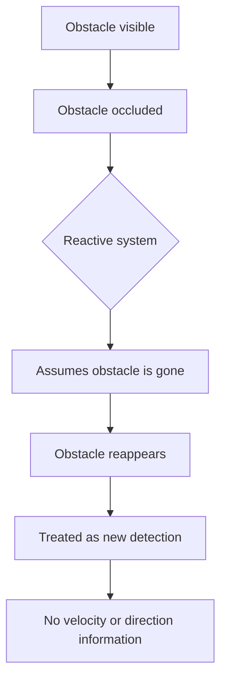

# Research Question

# Why Reactive Obstacle Detection Systems Are Insufficient for Mobile Robotics?

---
## Abstract

Reactive obstacle detection systems respond only to the current observed state of the environment, without maintaining motion history or estimating future positions. This document argues that such systems are insufficient for mobile robotics in dynamic indoor environments. Four core limitations are identified: inability to compensate for sensor and processing latency, failure to handle temporary occlusion, propagation of sensor noise into unstable robot behavior and incompatibility with higher-level planning modules that require future state information. These limitations are not resolved by improving sensor hardware alone. They require a predictive perception architecture that tracks obstacles over time, estimates their velocity and predicts their short-term future positions. This document provides the motivation for the modular detection, tracking and prediction pipeline developed in this project using the ZED 2i stereo camera.

## 1. Introduction

Mobile robotic systems operating in indoor dynamic environments must decide how to move safely and efficiently in the presence of other moving objects. The simplest approach to this problem is a reactive system: the robot observes the current state of the environment and immediately responds to what it sees.

Reactive systems represent the simplest approach to obstacle avoidance and were historically used in early robotics systems. Within the research group context of this project, existing mobile robotics implementations rely on classical perception methods without motion prediction, making them effectively reactive with respect to dynamic obstacles. In dynamic environments where obstacles such as people, other robots or moving objects change their positions continuously, this reactive behavior exhibits fundamental limitations that reduce both safety and performance.

This document investigates why reactive obstacle detection systems are insufficient for mobile robotics, with a focus on indoor environments where the ZED 2i stereo camera is used as the primary depth sensor.

---

## 2. What is a Reactive System

A reactive system makes decisions based only on the current observed state of the environment. It does not maintain a history of previous observations and does not estimate future states.

*Figure 1. Decision loop of a reactive system. The system maps sensor input directly to a response without maintaining state history or estimating future positions.*

In the context of obstacle detection, a reactive system detects obstacles in the current frame and produces a response such as stopping or steering away. The system does not know where the obstacle was in the previous frame, how fast it is moving or where it will be in the next moment.

This means the system always acts on the present snapshot of the environment rather than on an understanding of how the environment is evolving over time.

---

## 3. Disadvantages of Reactive Systems

### 3.1 Inability to Handle Sensor Latency

Depth-based perception using a stereo camera such as the ZED 2i is not instantaneous. Stereo depth estimation, point cloud processing, detection and decision-making all introduce processing delays.

*Figure 2. Illustration of sensor latency: the delay between a computer mouse movement and the system receiving and processing the corresponding signal.*

In a reactive system, these delays mean that the robot is always responding to a state that is already in the past. The deeper the processing pipeline, the more outdated the information on which the robot acts.

Note that exact latency values depend on hardware, resolution and SDK settings. The ZED SDK provides GPU-accelerated depth estimation, but processing delay is unavoidable in any real system.

A reactive system has no mechanism to compensate for this latency. A predictive system can partially compensate by estimating where an obstacle will be at the time the response takes effect rather than where it was when the sensor captured the frame.

---

### 3.2 Temporary Occlusion

In indoor environments, moving obstacles frequently become temporarily invisible due to occlusion by other objects, walls or the camera field of view limits.

A reactive system treats temporary occlusion as if the obstacle has disappeared. When the obstacle reappears, the system responds as if it is a new detection with no motion history.

*Figure 3. Behavior of a reactive system during temporary occlusion. Without motion history, the system loses all information about the obstacle and cannot anticipate its reappearance.*

This is a significant problem in corridors, doorways and cluttered indoor spaces where brief occlusion events are common. A system that maintains a motion model for each tracked obstacle can continue estimating its position during occlusion and prepare a more appropriate response when the obstacle reappears.

---

### 3.3 Unstable and Oscillatory Behavior

When a robot relies only on the current sensor state to make decisions, small fluctuations in sensor readings can cause unstable behavior. Stereo depth sensors including the ZED 2i produce noisy depth estimates, particularly near object edges, on low-texture surfaces and under varying lighting conditions.

A reactive system directly translates this sensor noise into decision noise. The robot may oscillate between responses as the detected obstacle position fluctuates frame to frame, even when the real obstacle is moving smoothly.

This oscillatory behavior is problematic both for safety and for mechanical wear. It also reduces the predictability of the robot's behavior from the perspective of other people sharing the environment.

A predictive system with a filtering stage such as a Kalman filter can smooth the observed positions before estimating motion, producing more stable and consistent responses.

---

### 3.4 Lack of Future State Information

Mobile robots typically use multiple software layers. Lower-level perception modules produce obstacle information that is consumed by higher-level planning modules such as path planning and navigation.

Path planning algorithms generally require not only the current positions of obstacles but also estimates of where those obstacles will be during the time the robot executes its planned path. A path that is safe at planning time may not be safe by the time the robot reaches a particular point if the obstacle has moved.

*Figure 4. Software layers in a typical mobile robotics system. The perception module feeds obstacle state information to higher-level planning and navigation modules*

If the perception module only provides current positions, the planning module must either assume obstacles are static (which is incorrect in dynamic environments) or apply conservative safety margins that significantly reduce the robot's efficiency and speed.

Providing predicted future positions allows the planning module to plan paths that are dynamically aware, reducing unnecessary stops and detours.

---

## 4. Summary of Limitations

| Limitation                    | Description                            | Consequence                                              |
| ----------------------------- | -------------------------------------- | -------------------------------------------------------- |
| No latency compensation       | Processing delay is not accounted for  | Robot responds to an already outdated state              |
| No occlusion handling         | Occluded objects are treated as gone   | Loss of obstacle information during brief disappearances |
| Sensor noise propagation      | Noisy detections cause noisy decisions | Oscillatory and unstable robot behavior                  |
| Incompatibility with planning | Only current positions provided        | Path planning must assume static obstacles               |
*Table 2. Summary of reactive system limitations*

---

## 5. Proposed Solution

The limitations of reactive systems motivate the need for a predictive perception pipeline. Such a system maintains a model of each obstacle's motion over time and uses this model to estimate future positions.

The minimum capabilities required beyond a reactive system are:
- **Object tracking** - maintaining consistent identity of each obstacle across frames
- **Velocity estimation** - estimating the current motion direction and speed of each obstacle
- **Short-term prediction** - estimating where each obstacle will be within a defined future horizon

These capabilities allow the robot to act on anticipated future states rather than on the observed past state, directly addressing the limitations identified in this document.

This is the motivation for the modular detection, tracking and prediction pipeline described in the project plan and implemented using the ZED 2i stereo camera as the primary depth sensor.

---

## 6. Conclusion

Reactive obstacle detection systems are insufficient for mobile robotics in dynamic indoor environments because they act only on the current observed state of the environment. This causes inability to compensate for processing latency, loss of obstacle information during occlusion and unstable behavior due to sensor noise. Furthermore, higher-level planning modules require future state information that reactive systems cannot provide.

These limitations are not solved by improving sensor quality alone. They require a different architecture: one that tracks obstacles over time, estimates their motion and predicts their short-term future positions. This is the core motivation for the perception pipeline developed in this project.

---

## References

Thrun, S., Burgard, W., & Fox, D. (2005). _Probabilistic robotics_. MIT Press.

Lavalle, S. M. (2006). _Planning algorithms_. Cambridge University Press. http://planning.cs.uiuc.edu/

Bewley, A., Ge, Z., Ott, L., Ramos, F., & Upcroft, B. (2016). Simple online and realtime tracking. _2016 IEEE International Conference on Image Processing (ICIP)_, 3464-3468. https://doi.org/10.1109/ICIP.2016.7533003

Abdelsalam, A., Mansour, M., Porras, J., & Happonen, A. (2024). Depth accuracy analysis of the ZED 2i stereo camera in an indoor environment. _Robotics and Autonomous Systems, 179_, Article 104753. https://doi.org/10.1016/j.robot.2024.104753