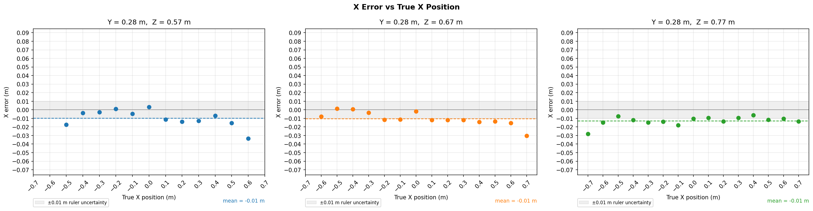
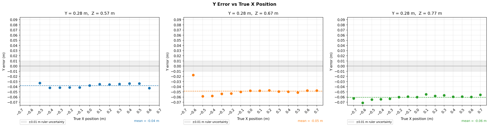
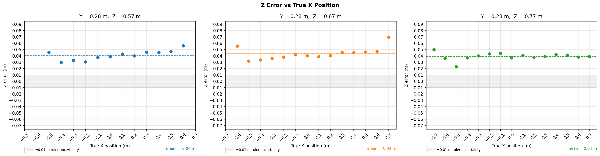

---
header-includes:
  - \usepackage{float}
  - \floatplacement{figure}{H}
---

# Research question:

# What is the detection accuracy of the YOLO and ZED depth pipeline?

---

## Objective

Quantify the 3D position error (x, y, z) of the YOLO and ZED depth pipeline on a stationary tennis ball across a known grid of positions and identify systematic biases to inform downstream use of the pipeline.

---

## Setup

**Equipment**: ZED stereo camera, NEURAL depth mode. Ball resting on the ground plane, placed stationary at grid positions measured with a ruler from the left camera lens to the ball centre.

**Coordinate system** (camera frame):

- X - left/right (positive = right)

- Y - up/down (positive = down)

- Z - distance from camera

**Camera tilt**: pitch = -0.01°, roll = -0.09° (measured via ZED IMU). Effect at 0.80 m: <1.3 mm - negligible.

**Grid**: 45 captures total. Z in {0.57, 0.67, 0.77} m, X in {-0.7 … 0.7} m in 0.1 m steps, ball resting on the ground plane (Y = 0.28 m). All positions measured with a ruler, manual measurement accuracy is ±1 cm.

Camera intrinsics - fx and fy (focal lengths in pixels along the horizontal and vertical axes) and cx and cy (principal point coordinates, the pixel location of the optical axis) - are stored in `intrinsics.json` in the dataset directory, written automatically on first capture.

---

## Detection Pipeline

1. **YOLO v8x** detects the ball and returns a bounding box (bbox).
2. **Front-face depth sampling**: within the bbox, the cluster of pixels within 0.5 cm of the minimum depth is selected. Their pixel centroid is used as the (u, v) deprojection point and their median depth as Z.
3. **XYZ lookup**: X and Y are read from the pre-computed XYZ map at the pixel centroid (u, v), using the depth at that pixel: `x = (u - cx) * z_uv / fx`, `y = (v - cy) * z_uv / fy`. Z is returned as the median depth of the front-face cluster. The two depth values (z_uv and median z) are nearly identical since the front-face pixels lie within 0.5 cm of each other.

The front-face approach is used instead of the bbox centre to reduce the Y error caused by deeper floor/background pixels inside the bbox. Selecting only the minimum-depth cluster removes most of that contamination, but the method still returns a front-surface centroid rather than the ball's geometric centre, so a residual Y bias remains (see Analysis).

---

## Results

**Detection rate**: 41 / 45. The 4 missed captures (caps 30, 31, 44, 45) correspond to the ball being physically outside the camera's field of view at extreme lateral positions at the two shorter Z distances.

**Summary** (camera minus ruler):

| Axis      | Mean error | Std    | Character                            |
|-----------|------------|--------|--------------------------------------|
| X         | -1.1 cm    | 0.8 cm | Small, no strong systematic trend   |
| Y         | -5.0 cm    | 1.1 cm | Systematic negative bias            |
| Z         | 4.1 cm     | 0.8 cm | Systematic positive bias            |
| \|Error\| | 6.7 cm     | 0.9 cm | -                                   |

**Plots** - each figure shows one error metric vs true X position, split into three panels by Z distance. The dashed line is the per-panel mean; the gray band is the ±0.01 m ruler uncertainty. Colors indicate depth distance:

- Blue - Z = 0.57 m
- Orange - Z = 0.67 m
- Green - Z = 0.77 m

---

---

---

---

---

## Analysis

The pipeline shows reliable lateral (X) localisation and two consistent systematic biases: a negative Y error and a positive Z error, both present across all tested positions.

**X error** (mean -1.1 cm, std 0.8 cm) is the smallest of the three axes and shows no consistent systematic trend. Values are predominantly small and negative, with no clear dependence on X position or Z distance. The mean is slightly negative and comparable in magnitude to the ±1 cm ruler measurement uncertainty, so no strong lateral bias can be claimed. At extreme lateral positions (ball near the left or right edge of the camera frame) the error is marginally larger, likely due to reduced stereo matching quality near frame edges, but the effect is small.

**Y error** (mean -5.0 cm, std 1.1 cm) is the most consistent systematic bias. The camera consistently places the ball 3-7 cm higher than the ruler measurement. The most likely reason is that the pipeline deprojects the centroid of the minimum-depth cluster, which lies on the visible front/upper surface of the ball, not at the ball's geometric centre. Because the camera is above the ball, that front-face centroid appears above the true centre in image space; deprojection therefore produces a smaller Y value and the ball is estimated too high. This dataset supports the existence of a stable residual Y bias, but it does not isolate the exact geometric contribution beyond that front-face-versus-centre mismatch.

**Z error** (mean 4.1 cm, std 0.8 cm) is a consistent positive bias across all captures and distances. The most likely cause is ZED NEURAL depth mode, which commonly exhibits a positive systematic bias at close range (< 1 m). An additional contribution may come from the ruler reference point: distances were measured from the left camera lens, which may not coincide exactly with the ZED's calibrated optical centre used for depth computation. The bias does not strongly depend on X or Z distance within this dataset's range, though there is a slight uptick at extreme lateral positions (ball near the left or right edge of the camera frame) where stereo matching quality is lower. No correction has been applied.

---

## Limitations

- **Ground truth method**: positions were measured by hand with a ruler. Ruler placement error (~1 cm) and ball positioning error contribute to the reported error figures. The error numbers are an upper bound on actual pipeline error.
- **ZED calibration**: the factory calibration is used without custom target-based recalibration. A custom calibration could reduce both the systematic Z bias and any residual distortion contributing to X error at frame edges.
- **Limited coverage**: the grid does not test Y positions other than floor height, nor Z beyond 0.77 m. Errors may be larger at longer ranges or different heights.
- **Static ball only**: the pipeline is evaluated on a stationary ball. Dynamic captures may introduce additional blur or YOLO confidence effects not captured here.

---

## Recommendations

- **Y correction**: add +5.0 cm to the measured Y value as a post-hoc correction if absolute Y accuracy is required. The std (1.1 cm) makes this practical.
- **Z correction**: apply a fixed -4.1 cm Z offset similarly. The low std (0.8 cm) makes this practical, though edge-of-frame positions may need a slightly larger correction.
- **Custom calibration**: if sub-3 cm accuracy is required, a custom ZED calibration and Z-distance-dependent correction curve would be the next step.

---

## Appendix: Per-capture data

Error = camera minus ruler. Blank = out of frame (missed).

| # | Image | Det | X (m) | Y (m) | Z (m) | Err X | Err Y | Err Z | \|Error\| |
|---|-------|-----|-------|-------|-------|-------|-------|-------|-----------|
| 1 | cap_001 | yes | 0.69 | 0.22 | 0.81 | -0.01 | -0.06 | 0.04 | 0.07 |
| 2 | cap_002 | yes | 0.59 | 0.22 | 0.81 | -0.01 | -0.06 | 0.04 | 0.07 |
| 3 | cap_003 | yes | 0.49 | 0.22 | 0.81 | -0.01 | -0.06 | 0.04 | 0.07 |
| 4 | cap_004 | yes | 0.39 | 0.22 | 0.81 | -0.01 | -0.06 | 0.04 | 0.07 |
| 5 | cap_005 | yes | 0.29 | 0.22 | 0.81 | -0.01 | -0.06 | 0.04 | 0.07 |
| 6 | cap_006 | yes | 0.19 | 0.22 | 0.81 | -0.01 | -0.06 | 0.04 | 0.07 |
| 7 | cap_007 | yes | 0.09 | 0.23 | 0.81 | -0.01 | -0.05 | 0.04 | 0.07 |
| 8 | cap_008 | yes | -0.01 | 0.22 | 0.81 | -0.01 | -0.06 | 0.04 | 0.07 |
| 9 | cap_009 | yes | -0.12 | 0.22 | 0.81 | -0.02 | -0.06 | 0.04 | 0.08 |
| 10 | cap_010 | yes | -0.21 | 0.22 | 0.81 | -0.01 | -0.06 | 0.04 | 0.08 |
| 11 | cap_011 | yes | -0.31 | 0.22 | 0.81 | -0.01 | -0.06 | 0.04 | 0.08 |
| 12 | cap_012 | yes | -0.41 | 0.22 | 0.81 | -0.01 | -0.06 | 0.04 | 0.07 |
| 13 | cap_013 | yes | -0.51 | 0.22 | 0.79 | -0.01 | -0.06 | 0.02 | 0.07 |
| 14 | cap_014 | yes | -0.61 | 0.21 | 0.81 | -0.01 | -0.07 | 0.04 | 0.08 |
| 15 | cap_015 | yes | -0.73 | 0.22 | 0.82 | -0.03 | -0.06 | 0.05 | 0.08 |
| 16 | cap_016 | yes | 0.67 | 0.23 | 0.74 | -0.03 | -0.05 | 0.07 | 0.09 |
| 17 | cap_017 | yes | 0.58 | 0.23 | 0.72 | -0.02 | -0.05 | 0.05 | 0.07 |
| 18 | cap_018 | yes | 0.49 | 0.23 | 0.72 | -0.01 | -0.05 | 0.05 | 0.07 |
| 19 | cap_019 | yes | 0.39 | 0.23 | 0.71 | -0.01 | -0.05 | 0.04 | 0.07 |
| 20 | cap_020 | yes | 0.29 | 0.23 | 0.72 | -0.01 | -0.05 | 0.05 | 0.07 |
| 21 | cap_021 | yes | 0.19 | 0.23 | 0.71 | -0.01 | -0.05 | 0.04 | 0.06 |
| 22 | cap_022 | yes | 0.09 | 0.23 | 0.71 | -0.01 | -0.05 | 0.04 | 0.06 |
| 23 | cap_023 | yes | -0.00 | 0.23 | 0.71 | -0.00 | -0.05 | 0.04 | 0.06 |
| 24 | cap_024 | yes | -0.11 | 0.23 | 0.71 | -0.01 | -0.05 | 0.04 | 0.07 |
| 25 | cap_025 | yes | -0.21 | 0.23 | 0.71 | -0.01 | -0.05 | 0.04 | 0.07 |
| 26 | cap_026 | yes | -0.30 | 0.23 | 0.71 | -0.00 | -0.05 | 0.04 | 0.06 |
| 27 | cap_027 | yes | -0.40 | 0.22 | 0.70 | 0.00 | -0.06 | 0.03 | 0.07 |
| 28 | cap_028 | yes | -0.50 | 0.22 | 0.70 | 0.00 | -0.06 | 0.03 | 0.07 |
| 29 | cap_029 | yes | -0.61 | 0.26 | 0.73 | -0.01 | -0.02 | 0.06 | 0.06 |
| 30 | cap_030 | no | - | - | - | - | - | - | - |
| 31 | cap_031 | no | - | - | - | - | - | - | - |
| 32 | cap_032 | yes | 0.57 | 0.24 | 0.63 | -0.03 | -0.04 | 0.06 | 0.08 |
| 33 | cap_033 | yes | 0.48 | 0.25 | 0.62 | -0.02 | -0.03 | 0.05 | 0.06 |
| 34 | cap_034 | yes | 0.39 | 0.25 | 0.61 | -0.01 | -0.03 | 0.04 | 0.06 |
| 35 | cap_035 | yes | 0.29 | 0.25 | 0.62 | -0.01 | -0.03 | 0.05 | 0.06 |
| 36 | cap_036 | yes | 0.19 | 0.24 | 0.61 | -0.01 | -0.04 | 0.04 | 0.06 |
| 37 | cap_037 | yes | 0.09 | 0.24 | 0.61 | -0.01 | -0.04 | 0.04 | 0.06 |
| 38 | cap_038 | yes | 0.00 | 0.24 | 0.61 | 0.00 | -0.04 | 0.04 | 0.05 |
| 39 | cap_039 | yes | -0.10 | 0.24 | 0.61 | -0.00 | -0.04 | 0.04 | 0.06 |
| 40 | cap_040 | yes | -0.20 | 0.24 | 0.60 | 0.00 | -0.04 | 0.03 | 0.05 |
| 41 | cap_041 | yes | -0.30 | 0.24 | 0.60 | -0.00 | -0.04 | 0.03 | 0.05 |
| 42 | cap_042 | yes | -0.40 | 0.24 | 0.60 | -0.00 | -0.04 | 0.03 | 0.05 |
| 43 | cap_043 | yes | -0.52 | 0.25 | 0.62 | -0.02 | -0.03 | 0.05 | 0.06 |
| 44 | cap_044 | no | - | - | - | - | - | - | - |
| 45 | cap_045 | no | - | - | - | - | - | - | - |
