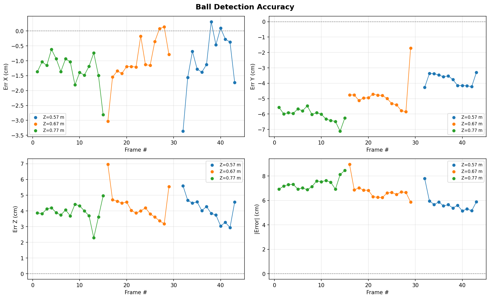

# Ball Detection Accuracy Experiment

## Research question:

## What is the detection accuracy of the YOLO and ZED depth pipeline?

---

## Objective

Quantify the 3D position error of the YOLO and ZED depth pipeline on a stationary ball across a known grid of positions and identify systematic biases to inform downstream use of the pipeline.

---

## Setup

**Equipment**: ZED stereo camera, NEURAL depth mode. Ball placed stationary at grid positions measured with a ruler from the left camera lens to the ball centre.

**Coordinate system** (camera frame):

- X - left/right (positive = right)

- Y - up/down (positive = down)

- Z - distance from camera

**Camera tilt**: pitch = -0.01°, roll = -0.09° (measured via ZED IMU). Effect at 0.80 m: <1.3 mm - negligible.

**Grid**: 47 captures total.

- Primary grid: Z in {0.57, 0.67, 0.77} m, X in {-0.7 … 0.7} m in 0.1 m steps, ball on floor (Y = 0.28 m) - 45 captures

- Elevated: X in {0.1, 0.3} m, Z = 0.67 m, Y = 0.175 m - 2 captures

Camera intrinsics (fx, fy, cx, cy) are stored in `intrinsics.json` in the dataset directory, written automatically on first capture.

---

## Detection Pipeline

1. **YOLO v8x** detects the ball and returns a bounding box (bbox).
2. **Front-face depth sampling**: within the bbox, the cluster of pixels within 0.5 cm of the minimum depth is selected. Their pixel centroid is used as the (u, v) deprojection point and their median depth as Z.
3. **Deprojection**: `x = (u - cx) * z / fx`, `y = (v - cy) * z / fy`.

The front-face approach is used instead of the bbox centre to reduce the systematic Y error caused by the floor occluding the ball's lower half inside the bbox. This reduced Y bias from ~5-7 cm to ~3-6 cm compared to using the bbox centre.

---

## Results

**Detection rate**: 43 / 47. The 4 missed captures (caps 30, 31, 44, 45) correspond to the ball being physically outside the camera's field of view at extreme lateral positions (X = -0.7 m and X = -0.6 m) at the two shorter Z distances.

**Summary** (camera minus ruler):

| Axis      | Mean error | Std    | Character                            |
|-----------|------------|--------|--------------------------------------|
| X         | -1.0 cm    | 0.9 cm | Small, no strong systematic trend   |
| Y         | -4.9 cm    | 1.2 cm | Systematic negative bias            |
| Z         | 4.0 cm     | 0.8 cm | Systematic positive bias            |
| \|Error\| | 6.6 cm     | 1.0 cm | -                                   |

**Plot** - each subplot shows one error metric across all detected frames. Colors indicate depth distance; markers indicate ball height:

- Blue circles / line - Z = 0.57 m, floor (Y = 0.28 m)
- Orange circles / line - Z = 0.67 m, floor (Y = 0.28 m)
- Green circles / line - Z = 0.77 m, floor (Y = 0.28 m)
- Triangles / dashed - elevated captures (Y = 0.175 m, Z = 0.67 m, orange)

---

## Analysis

**X error** (mean -1.0 cm, std 0.9 cm) is the smallest of the three axes and shows no consistent systematic trend. The sign alternates across frames and depth distances. The mean is slightly negative but within the noise level, indicating the lateral position is measured reliably. At extreme lateral positions the error is marginally larger, likely due to reduced depth quality near frame edges, but the effect is small.

**Y error** (mean -4.9 cm, std 1.2 cm) is the most consistent systematic bias in the dataset. The camera consistently places the ball 3-6 cm higher than the ruler measurement. The mechanism is floor occlusion: the ball rests on the floor, and YOLO's bounding box does not cleanly separate the bottom of the ball from the floor surface. The effective image centre of the detected ball is shifted upward relative to the true ball centre, causing deprojection to underestimate Y. Two factors modulate the magnitude: (1) Z distance - the bias is slightly larger at Z = 0.77 m (~5-6 cm) than at Z = 0.57 m (~3-4 cm), because at greater distance the ball occupies fewer pixels and the bbox boundary is less precise; (2) ball height - the two elevated captures (caps 46-47, Y = 0.175 m) show only -3 cm bias, confirming that less floor contact means less occlusion and a more accurate Y reading.

**Z error** (mean 4.0 cm, std 0.8 cm) is a consistent positive bias across all captures and distances. The primary cause is ZED NEURAL depth mode, which has a documented positive systematic bias at close range (< 1 m). The bias does not strongly depend on X or Z distance within this dataset's range, though there is a slight uptick at extreme lateral positions (frame edges) where stereo matching quality is lower. A secondary contribution may come from factory calibration: the ZED's calibrated optical centre is a virtual point that may not coincide exactly with the physical reference surface of the camera body used for ruler measurements. No correction has been applied.

**Elevated captures** (caps 46-47) show consistently lower errors across all axes - approximately 4-5 cm |Error| versus 6-8 cm for floor captures. This is the clearest evidence that floor proximity is the dominant accuracy-limiting factor for Y and that the pipeline's absolute accuracy improves when the ball is not in contact with the floor.

---

## Limitations

- **Ground truth method**: positions were measured by hand with a ruler. Ruler placement error (~1 cm) and ball positioning error contribute to the reported error figures. The error numbers are an upper bound on actual pipeline error.
- **ZED calibration**: the factory calibration is used without custom target-based recalibration. A custom calibration could reduce both the systematic Z bias and any residual distortion contributing to X error at frame edges.
- **Limited coverage**: the grid does not test Y positions other than floor and one elevated height, nor Z beyond 0.77 m. Errors may be larger at longer ranges or different heights.
- **Static ball only**: the pipeline is evaluated on a stationary ball. Dynamic captures may introduce additional blur or YOLO confidence effects not captured here.

---

## Recommendations

- **Y correction**: apply a fixed 4.9 cm Y offset as a post-hoc correction if absolute Y accuracy is required. The std (1.2 cm) makes this practical.
- **Z correction**: apply a fixed -4.0 cm Z offset similarly. The low std (0.8 cm) makes this practical, though edge-of-frame positions may need a slightly larger correction.
- **Elevated ball**: if the application allows, keeping the ball off the floor significantly improves accuracy (~4-5 cm |Error| vs ~6-8 cm).
- **Custom calibration**: if sub-3 cm accuracy is required, a custom ZED calibration and Z-distance-dependent correction curve would be the next step.

---

## Appendix: Per-capture data

Error = camera minus ruler. Blank = out of frame (missed).

| # | Image | Det | X (m) | Y (m) | Z (m) | Err X | Err Y | Err Z | \|Error\| |
|---|-------|-----|-------|-------|-------|-------|-------|-------|-----------|
| 1 | cap_001 | yes | 0.69 | 0.22 | 0.81 | -0.01 | -0.06 | 0.04 | 0.07 |
| 2 | cap_002 | yes | 0.59 | 0.22 | 0.81 | -0.01 | -0.06 | 0.04 | 0.07 |
| 3 | cap_003 | yes | 0.49 | 0.22 | 0.81 | -0.01 | -0.06 | 0.04 | 0.07 |
| 4 | cap_004 | yes | 0.39 | 0.22 | 0.81 | -0.01 | -0.06 | 0.04 | 0.07 |
| 5 | cap_005 | yes | 0.29 | 0.22 | 0.81 | -0.01 | -0.06 | 0.04 | 0.07 |
| 6 | cap_006 | yes | 0.19 | 0.22 | 0.81 | -0.01 | -0.06 | 0.04 | 0.07 |
| 7 | cap_007 | yes | 0.09 | 0.23 | 0.81 | -0.01 | -0.05 | 0.04 | 0.07 |
| 8 | cap_008 | yes | -0.01 | 0.22 | 0.81 | -0.01 | -0.06 | 0.04 | 0.07 |
| 9 | cap_009 | yes | -0.12 | 0.22 | 0.81 | -0.02 | -0.06 | 0.04 | 0.08 |
| 10 | cap_010 | yes | -0.21 | 0.22 | 0.81 | -0.01 | -0.06 | 0.04 | 0.08 |
| 11 | cap_011 | yes | -0.31 | 0.22 | 0.81 | -0.01 | -0.06 | 0.04 | 0.08 |
| 12 | cap_012 | yes | -0.41 | 0.22 | 0.81 | -0.01 | -0.06 | 0.04 | 0.07 |
| 13 | cap_013 | yes | -0.51 | 0.22 | 0.79 | -0.01 | -0.06 | 0.02 | 0.07 |
| 14 | cap_014 | yes | -0.61 | 0.21 | 0.81 | -0.01 | -0.07 | 0.04 | 0.08 |
| 15 | cap_015 | yes | -0.73 | 0.22 | 0.82 | -0.03 | -0.06 | 0.05 | 0.08 |
| 16 | cap_016 | yes | 0.67 | 0.23 | 0.74 | -0.03 | -0.05 | 0.07 | 0.09 |
| 17 | cap_017 | yes | 0.58 | 0.23 | 0.72 | -0.02 | -0.05 | 0.05 | 0.07 |
| 18 | cap_018 | yes | 0.49 | 0.23 | 0.72 | -0.01 | -0.05 | 0.05 | 0.07 |
| 19 | cap_019 | yes | 0.39 | 0.23 | 0.71 | -0.01 | -0.05 | 0.04 | 0.07 |
| 20 | cap_020 | yes | 0.29 | 0.23 | 0.72 | -0.01 | -0.05 | 0.05 | 0.07 |
| 21 | cap_021 | yes | 0.19 | 0.23 | 0.71 | -0.01 | -0.05 | 0.04 | 0.06 |
| 22 | cap_022 | yes | 0.09 | 0.23 | 0.71 | -0.01 | -0.05 | 0.04 | 0.06 |
| 23 | cap_023 | yes | -0.00 | 0.23 | 0.71 | -0.00 | -0.05 | 0.04 | 0.06 |
| 24 | cap_024 | yes | -0.11 | 0.23 | 0.71 | -0.01 | -0.05 | 0.04 | 0.07 |
| 25 | cap_025 | yes | -0.21 | 0.23 | 0.71 | -0.01 | -0.05 | 0.04 | 0.07 |
| 26 | cap_026 | yes | -0.30 | 0.23 | 0.71 | -0.00 | -0.05 | 0.04 | 0.06 |
| 27 | cap_027 | yes | -0.40 | 0.22 | 0.70 | 0.00 | -0.06 | 0.03 | 0.07 |
| 28 | cap_028 | yes | -0.50 | 0.22 | 0.70 | 0.00 | -0.06 | 0.03 | 0.07 |
| 29 | cap_029 | yes | -0.61 | 0.26 | 0.73 | -0.01 | -0.02 | 0.06 | 0.06 |
| 30 | cap_030 | no | - | - | - | - | - | - | - |
| 31 | cap_031 | no | - | - | - | - | - | - | - |
| 32 | cap_032 | yes | 0.57 | 0.24 | 0.63 | -0.03 | -0.04 | 0.06 | 0.08 |
| 33 | cap_033 | yes | 0.48 | 0.25 | 0.62 | -0.02 | -0.03 | 0.05 | 0.06 |
| 34 | cap_034 | yes | 0.39 | 0.25 | 0.61 | -0.01 | -0.03 | 0.04 | 0.06 |
| 35 | cap_035 | yes | 0.29 | 0.25 | 0.62 | -0.01 | -0.03 | 0.05 | 0.06 |
| 36 | cap_036 | yes | 0.19 | 0.24 | 0.61 | -0.01 | -0.04 | 0.04 | 0.06 |
| 37 | cap_037 | yes | 0.09 | 0.24 | 0.61 | -0.01 | -0.04 | 0.04 | 0.06 |
| 38 | cap_038 | yes | 0.00 | 0.24 | 0.61 | 0.00 | -0.04 | 0.04 | 0.05 |
| 39 | cap_039 | yes | -0.10 | 0.24 | 0.61 | -0.00 | -0.04 | 0.04 | 0.06 |
| 40 | cap_040 | yes | -0.20 | 0.24 | 0.60 | 0.00 | -0.04 | 0.03 | 0.05 |
| 41 | cap_041 | yes | -0.30 | 0.24 | 0.60 | -0.00 | -0.04 | 0.03 | 0.05 |
| 42 | cap_042 | yes | -0.40 | 0.24 | 0.60 | -0.00 | -0.04 | 0.03 | 0.05 |
| 43 | cap_043 | yes | -0.52 | 0.25 | 0.62 | -0.02 | -0.03 | 0.05 | 0.06 |
| 44 | cap_044 | no | - | - | - | - | - | - | - |
| 45 | cap_045 | no | - | - | - | - | - | - | - |
| 46 | cap_046 | yes | 0.12 | 0.14 | 0.70 | 0.02 | -0.03 | 0.03 | 0.05 |
| 47 | cap_047 | yes | 0.31 | 0.15 | 0.69 | 0.01 | -0.03 | 0.02 | 0.04 |
